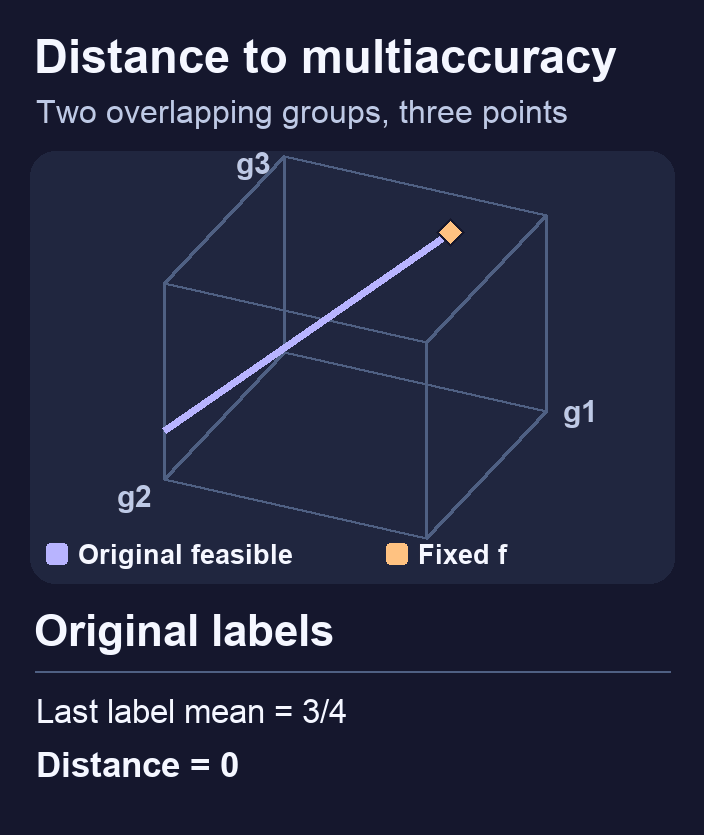

# Sample complexity of distance to multiaccuracy

   

Estimating the L1 distance to exact multiaccuracy on k groups takes k^((1/2 + o(1))k) labeled samples in the worst case at fixed small additive error. The upper bound is independent of the domain size and uses a linear program polynomial in the sample count. The lower bound holds on k + 1 points even when the marginal is known.

[Read the paper](paper/manuscript.pdf) · [LaTeX source](paper/manuscript.tex) · [Proof outline](proof/PROBLEM_AND_PROOF.md) · [Run the replay](REPRODUCIBILITY.md)

## A small label shift forces a repair

For the overlapping groups {1, 2} and {2, 3}, the exact group constraints leave a line of possible scores. The fixed predictor is (3/4, 1/4, 1). When just the last point's label mean rises from 3/4 to 7/8, the nearest feasible scores become (5/8, 3/8, 1). The weighted L1 distance is 1/12.

[Download the offline explorer](https://raw.githubusercontent.com/DannyExperiments/multiaccuracy-distance-sample-complexity/refs/tags/v1.0.0/visualization/score-repair-explorer.zip), extract it, and open index.html. Change the last label mean and rotate the score cube. [Figure guide](visualization/README.md)

## Sources and scope

This result answers Derhake et al.'s statistical auditing question for distance to exact multiaccuracy in the catalog's labeled-sample model. The lower bound adapts Alon and Vũ's augmented binary matrix. The companion gives streaming counters for independent membership patterns and connects their distance formula to discrete L1 estimation. [Original question](https://arxiv.org/html/2509.16930#S4) · [Pinned Q572](https://github.com/10m-u/open-problems-catalog/blob/ca8d4d44ba3db527f19f28928c240168f545ecfe/problems/computer_science_ai/classical-statistical-machine-learning.md#q572)

[Mathematical audit](audits/public_safe_reports/MATHEMATICAL_AUDIT.md) · [Literature audit](audits/public_safe_reports/LITERATURE_AUDIT.md) · [Scope](CLAIM_SCOPE_AND_LIMITATIONS.md) · [AI disclosure](AI_DISCLOSURE.md) · [Status](STATUS.md)

[Release v1.0.0](https://github.com/DannyExperiments/multiaccuracy-distance-sample-complexity/releases/tag/v1.0.0) · [Version DOI](https://doi.org/10.5281/zenodo.24572314) · [Citation](CITATION.cff)

## Partial Lean verification

Over the rational unit cube for the three-atom example, the two group constraints force mean absolute repair distance at least 1/12. The repair (5/8, 3/8, 1) attains that bound. [Scope, source and replay](formalization/README.md)
